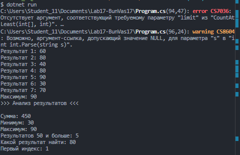

# Практическая работа №17

Автор: Буничева Дарья, Василенко Полина  
Группа: ИСП-252

## Тема

Алгоритмы обработки массивов.

## Что реализовано

- сумма элементов;
- подсчёт элементов по условию;
- минимум и максимум;
- линейный поиск;
- поиск первого индекса.

## Короткие ответы

1. Почему максимум нельзя всегда начинать с `0`?

Ответ: массив может содержать только отрицательные числа

2. Что означает `-1` после поиска индекса?

Ответ: искомый элемент не найден в массиве

3. Чем сумма отличается от подсчёта элементов?

Ответ: сумма складывает все элементы, а подсчет считает их количество

## Результат

